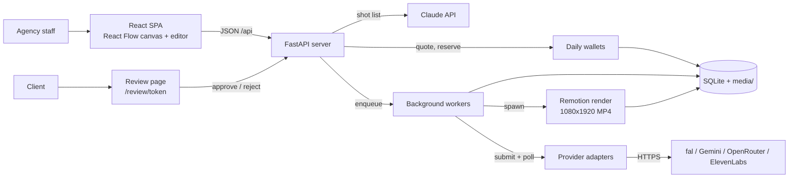

# Build Club

**Remake**: an AI short-video ad tool for social media agencies. Start from a reference video, turn it into a shot list, generate storyboard frames and AI video clips on a node canvas, edit and export a vertical ad, then send it to the client for approval on a no-login link.

Built during the UTS Startups × Build Club 8-week AI Build Sprint (Sep–Nov 2026). Target market: Australian agencies, English video content. Desktop only (1440 wide); the UI also runs in Traditional Chinese.

## How it works



- **Front end:** React 19, TypeScript, Vite, React Flow (`@xyflow/react`) for the canvas, Remotion Player for preview.
- **Back end:** one FastAPI server (port 8787). Data lives in one SQLite file plus a media folder on disk.
- **AI generation:** every provider sits behind the same `submit` / `poll` adapter (`backend/gen_providers.py`); models and prices are listed in `backend/gen_models.json`. Background worker threads (one each for image, video and voice) run the jobs, so a long video never blocks an image.
- **Export:** the server runs `render/render-reel.mjs` (Remotion 4) as a child process, then checks the MP4 with ffprobe: 1080x1920, 30 fps, with audio, length matching the timeline.
- **Client review:** a revocable 192-bit link per client. It shows only items waiting for review and can only approve or reject them.

## Cost control

AI video is paid per second, so spending is guarded on the server:

1. **Quote, then confirm.** A paid action first returns a price and three stamps (canvas version, inputs, quote). The confirm must send them back unchanged, or the server answers 409.
2. **Reserve before calling.** The cost is taken from a daily wallet before the provider is called (`DAILY_GEN_IMAGE_USD`, `DAILY_GEN_VIDEO_USD`, and so on). Over the cap, the server answers 429 and nothing is sent.
3. **Refund only when certain.** Money comes back only when nothing was sent, the provider refused, or it reported failure. A lost or timed-out request becomes `unknown` and stays charged, because the provider may have billed it.
4. **No automatic resubmits.** Trying again creates a new, visible charge.

## Repository layout

| Path | What |
| --- | --- |
| `pivots/02-content/app/trend-finder/` | The app: `backend/` (FastAPI), `src/` (React), `render/` (Remotion CLI), `e2e/` (Playwright), `unit/` (front-end tests) |
| `pivots/02-content/docs/` | Remake product docs, app flow, plans and specs |
| `docs/STATUS.md` | Current progress, last verification and next steps |
| `docs/test-log.md` | Every test run, including failed ones |
| `bin/` | Verification and isolated test backends |
| `pivots/01-geo/`, `PROJECT_CONTEXT.md` | The earlier **Recite** idea (AI mystery shopper for ChatGPT recommendations), kept for history |

## Run it

See [`pivots/02-content/app/trend-finder/README.md`](pivots/02-content/app/trend-finder/README.md). In short: create `backend/.venv` from `backend/requirements.txt`, start the API with `uvicorn server:app --app-dir backend --port 8787`, and run `npm run dev` for the front end. API keys come only from a git-ignored `.env` (`FAL_KEY`, `ANTHROPIC_API_KEY`, and others); never commit them.

To try the UI without spending money, `bash bin/isolated-backend.sh <port>` starts a throwaway backend with no `.env` and every daily budget at 0. It uses the free mock models.

## Verify

```bash
bash bin/verify.sh full
```

This runs offline in a macOS sandbox with no network access and no access to `.env`. It compiles and imports the backend, then runs the backend pytest suite and the front-end unit tests, and prints `verify: GREEN` or `RED`. Tests use a mock provider that produces real image and video files, so no paid API is called.

## Working on this repo

Branch off `main`, open a pull request against `main`, and merge only after review. Never push directly to `main`. Check `docs/STATUS.md` before starting.
